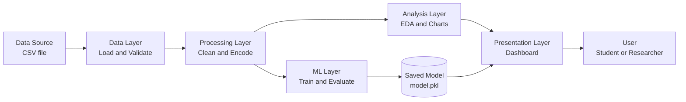
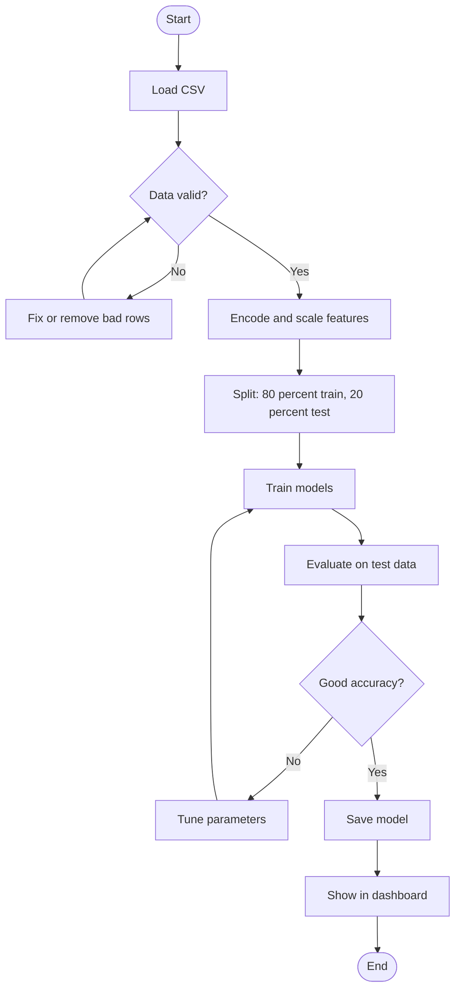
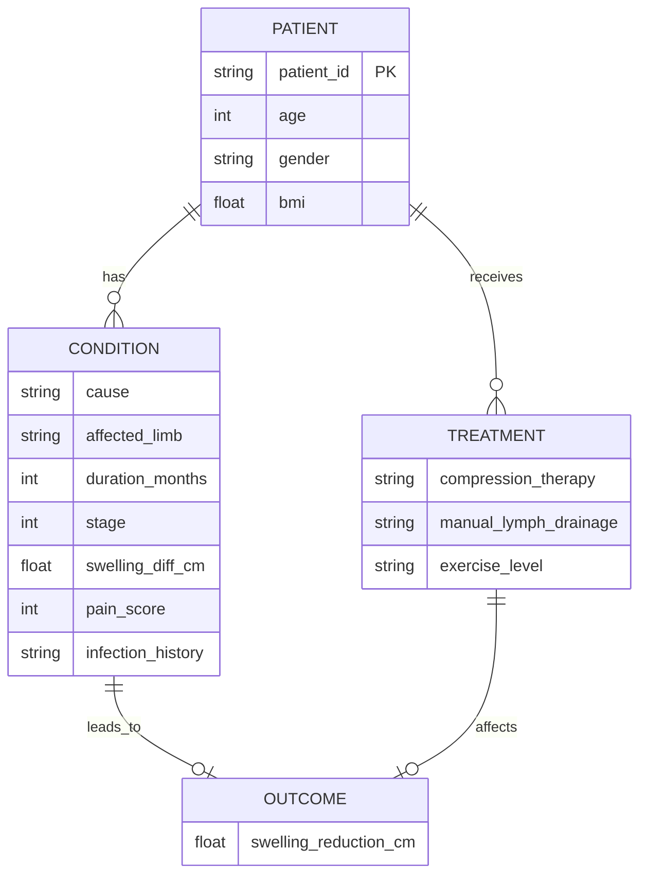
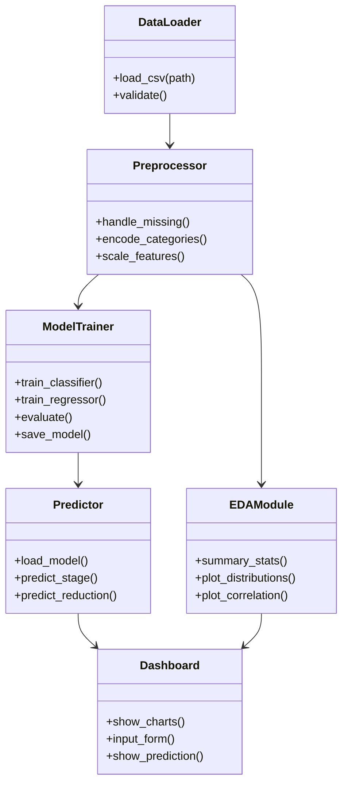
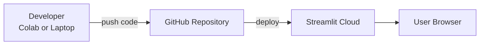
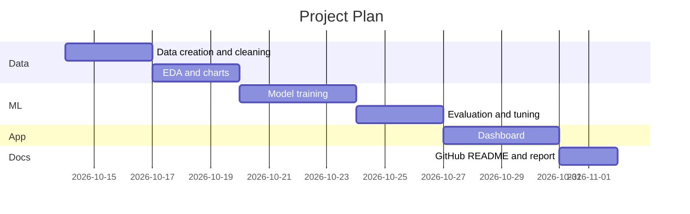

# Technical Design Document (TDD)
## Lymphedema Severity Analysis and Prediction System

| Item | Details |
|---|---|
| Author | Arya |
| Version | 1.0 |
| Status | Draft |
| Dataset | `lymphedema_sample_data.csv` (200 synthetic records) |

---

## 1. Introduction

### 1.1 Purpose
This document explains how the Lymphedema project is designed. It covers the architecture, data, models, and how the parts work together.

### 1.2 Problem Statement
- Lymphedema is long-term swelling of an arm or leg caused by a blocked lymph system.
- Early stage detection and treatment tracking are hard.
- This project analyzes patient data to find patterns and predict severity and treatment results.

### 1.3 Goals
- Clean and analyze lymphedema patient data.
- Predict the **stage (0-3)** of lymphedema.
- Predict **swelling reduction (cm)** after 3 months of treatment.
- Show results in a simple dashboard.

### 1.4 Non-Goals
- This is **not** a medical diagnosis tool.
- No real patient data is used (only synthetic data).

---

## 2. Scope

| In Scope | Out of Scope |
|---|---|
| Data cleaning and EDA | Real hospital integration |
| ML models (classification + regression) | Medical certification |
| Dashboard | Mobile app |
| GitHub documentation | Live patient monitoring |

---

## 3. System Architecture

### 3.1 High-Level Architecture



### 3.2 Layers Explained
- **Data Layer**: reads the CSV and checks for missing or wrong values.
- **Processing Layer**: cleans data, converts text to numbers (encoding), scales values.
- **Analysis Layer**: finds patterns using charts and statistics.
- **ML Layer**: trains and tests prediction models.
- **Presentation Layer**: shows results to the user.

---

## 4. Data Flow



---

## 5. Data Design

### 5.1 Data Dictionary

| Column | Type | Description |
|---|---|---|
| patient_id | String | Unique ID (P001...) |
| age | Integer | 25-80 |
| gender | Category | Female / Male |
| cause | Category | Reason for lymphedema |
| affected_limb | Category | Left/Right arm or leg |
| bmi | Float | Body mass index |
| duration_months | Integer | Months since swelling started |
| stage | Integer | 0-3 (**target 1**) |
| swelling_diff_cm | Float | Size difference vs healthy limb |
| pain_score | Integer | 0-10 |
| compression_therapy | Yes/No | Treatment given |
| manual_lymph_drainage | Yes/No | Treatment given |
| exercise_level | Category | Low / Medium / High |
| infection_history | Yes/No | Past infection |
| swelling_reduction_cm | Float | Improvement after 3 months (**target 2**) |

### 5.2 Entity Relationship Diagram



> Note: The CSV is one flat table. The diagram shows how the columns are grouped logically.

---

## 6. Component Design



| Component | Job |
|---|---|
| DataLoader | Read and check the CSV |
| Preprocessor | Make data ready for ML |
| EDAModule | Charts and insights |
| ModelTrainer | Train and save models |
| Predictor | Give predictions for new input |
| Dashboard | Show everything to the user |

---

## 7. Machine Learning Design

### 7.1 Models

| Task | Type | Target | Models to try |
|---|---|---|---|
| Predict stage | Classification | `stage` | Logistic Regression, Random Forest |
| Predict improvement | Regression | `swelling_reduction_cm` | Linear Regression, Random Forest |

### 7.2 Evaluation Metrics
- **Classification**: Accuracy, Precision, Recall, F1-score, Confusion Matrix
- **Regression**: MAE, RMSE, R-squared

### 7.3 Training Setup
- Split: 80% train / 20% test
- Cross-validation: 5-fold
- Random seed fixed (42) so results can be repeated

---

## 8. Sequence Diagram (User Prediction)

```mermaid
sequenceDiagram
    actor U as User
    participant D as Dashboard
    participant P as Predictor
    participant M as Saved Model
    U->>D: Enter patient details
    D->>D: Validate input
    D->>P: Send input data
    P->>M: Load model
    M-->>P: Model ready
    P->>P: Preprocess and predict
    P-->>D: Stage and expected reduction
    D-->>U: Show result with chart
```



---

## 9. Technology Stack

| Area | Tool |
|---|---|
| Language | Python 3 |
| Data | Pandas, NumPy |
| Charts | Matplotlib, Seaborn |
| ML | Scikit-learn |
| Dashboard | Streamlit |
| Notebook | Google Colab / Jupyter |
| Version control | Git and GitHub |

---

## 10. Deployment Architecture



---

## 11. Folder Structure

```
lymphedema-project/
├── data/
│   └── lymphedema_sample_data.csv
├── notebooks/
│   └── eda_and_modeling.ipynb
├── src/
│   ├── data_loader.py
│   ├── preprocess.py
│   ├── train.py
│   └── predict.py
├── app/
│   └── dashboard.py
├── models/
│   └── model.pkl
├── docs/
│   └── TECHNICAL_DESIGN_DOCUMENT.md
├── requirements.txt
└── README.md
```

---

## 12. Security and Privacy
- Only **synthetic data** is used. No real patient information.
- If real data is used later: remove names and IDs, get consent, and follow local health data rules.
- Do not upload private data to a public GitHub repo.

---

## 13. Testing Plan

| Test | What is checked |
|---|---|
| Data test | No missing values, correct ranges (age 25-80, pain 0-10) |
| Unit test | Each function works alone |
| Model test | Accuracy above target on test data |
| UI test | Dashboard shows correct output for sample input |

---

## 14. Risks and Solutions

| Risk | Solution |
|---|---|
| Small dataset (200 rows) | Use cross-validation, simple models |
| Synthetic data may not match real life | Clearly state this limitation |
| Overfitting | Use test split and regularization |
| Wrong use as medical advice | Add a disclaimer in the app |

---

## 15. Project Timeline



---

## 16. Future Improvements
- Add real (approved) clinical data.
- Add image-based swelling detection.
- Add more models (XGBoost).
- Build a mobile-friendly version.

---

## 17. Disclaimer
This project is for **learning and research only**. It is **not** a medical device and must not be used to diagnose or treat any condition.
